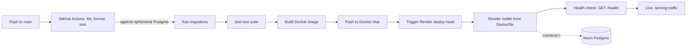

# 🌿 Plant Therapist

Emotional support tips for people who keep killing their houseplants.

**Live:** https://plant-therapist-51ic.onrender.com

Plant Therapist is a tiny, deliberately real-world subscriber-capture app — built less to be a product and more to be a proving ground for a production-grade CI/CD pipeline: lint and test on every push, build and push a Docker image, deploy automatically, and connect to a real managed Postgres database. No shortcuts, no mocked infrastructure.

---

## Tech Stack

- **Runtime:** Node.js 22, Express 5
- **Database:** PostgreSQL via [Drizzle ORM](https://orm.drizzle.team/) — [Neon](https://neon.tech) serverless Postgres in production, a throwaway `postgres:16` container in CI
- **Containerization:** Docker (multi-stage build: dependencies compiled in a `builder` stage, slim Alpine runtime image with `tini` for signal handling)
- **CI/CD:** GitHub Actions
- **Registry:** Docker Hub
- **Hosting:** Render (Docker-based web service)

---

## Architecture



Every push to `main` runs the full pipeline unattended: install → format check → lint → migrate → test → build → push → deploy → health-check. No manual steps once code lands on `main`.

---

## Local Development

```bash
git clone https://github.com/SheillaO/plant-therapist.git
cd plant-therapist
npm install
```

Create a `.env` file:

```dotenv
DATABASE_URL="your-neon-or-local-postgres-connection-string"
MIGRATION_DATABASE_URL="your-direct-non-pooled-connection-string"
```

> Leave `NODE_ENV` unset locally — the app only sets it to `production` inside the Docker image, so local runs get full, unmasked error output in the terminal.

```bash
npm run db:migrate   # apply schema to your database
npm start             # http://localhost:3000
```

Run the test suite:

```bash
npm test
```

---

## CI/CD Pipeline

Two jobs, defined in `.github/workflows/ci.yml`:

**`build-and-test`** — runs on every push and pull request against `main`:
- Spins up a throwaway `postgres:16` service container (CI has no database by default)
- Installs dependencies, checks Prettier formatting, runs ESLint
- Applies Drizzle migrations against the ephemeral database
- Runs the Jest suite

**`build-and-push`** — runs only on a push to `main`, after `build-and-test` passes:
- Builds the multi-stage Docker image
- Pushes it to Docker Hub, tagged both `latest` and with the commit SHA
- Calls Render's deploy hook to trigger a fresh deploy from the latest commit

---

## Shipping Notes: What Actually Broke, and Why

Standing up this pipeline surfaced ten distinct failure modes across formatting, database connections, migrations, secrets, and platform-specific deploy behavior — each a legitimate lesson, not a fluke.

| Symptom | Root Cause | Fix |
|---|---|---|
| `format:check` failing on CI | Prettier was linting its own workflow YAML and Drizzle's generated migration metadata | Scoped `.prettierignore` to exclude `.github/` and `drizzle/migrations/` |
| Tests failing with connection errors | No database exists on a fresh GitHub Actions runner by default | Added an ephemeral `postgres:16` service container with a health check |
| `The server does not support SSL connections` | SSL was hardcoded `true` for all Postgres connections, but local/CI Postgres doesn't support it | Made SSL conditional on whether the host is `localhost` |
| `column "email_address" does not exist` | A column rename was hand-written as a data backfill, with no underlying schema migration | Regenerated via `drizzle-kit generate`, selecting "rename column" so Drizzle produced a real `ALTER TABLE ... RENAME COLUMN` |
| Docker Hub auth failing in CI | Registry credentials were never stored as GitHub Actions secrets/variables | Added `DOCKERHUB_USERNAME` as a repo variable and an access token as a secret |
| Repeated invalid-YAML errors | A new step kept landing at the wrong indentation level, nested inside the previous step's block | Re-aligned every step to a consistent indent under `steps:` |
| `curl: Bad hostname` / `Malformed input to a URL function` | A pasted secret carried an invisible trailing newline | Sanitized with `tr -d '[:space:]'` before use, as a standing defensive habit |
| Local changes appearing to have zero effect | A previously-run Docker container was still bound to port 3000, silently serving stale code | Identified via `docker ps` / Docker Desktop GUI and removed with `docker rm -f` |
| Deploys intermittently marked "Timed Out" despite a successful boot | Render's port auto-detection raced against a slow container cold start | Set an explicit `PORT` environment variable to skip the scan entirely |
| Deploy marked "Failed" after a clean boot | Render's configured health check hit a route that didn't exist | Added a dedicated `GET /health` endpoint returning `200` |

**Takeaway:** most of these weren't application bugs — they were environment and pipeline assumptions that only break once you're actually running in a clean, ephemeral, production-shaped environment for the first time. That's exactly what a CI/CD pipeline is for.

---

## About

**Sheilla O.** Product Marketing Manager → Technical Product Marketing Manager | Nairobi, Kenya 🇰🇪

Former Twitter/X Strategic Partnerships Manager (Sub-Saharan Africa). Currently building technical credibility through shipped, production-deployed projects — because the best way to market developer tools is to build them.

This project is a full subscriber-capture pipeline: GitHub Actions running linting, formatting, and tests against an ephemeral Postgres instance, a Docker image built and pushed to Docker Hub, and an automated deploy hook to Render backed by a real Neon Postgres database — because understanding a deployment pipeline end to end beats reading about one.

💼 [LinkedIn](https://www.linkedin.com/in/sheillaolga/) · 🐙 [GitHub](https://github.com/SheillaO) · 🌿 [Live Demo](https://plant-therapist-51ic.onrender.com)

**No plants — or deploys — were harmed in the making of this app.**